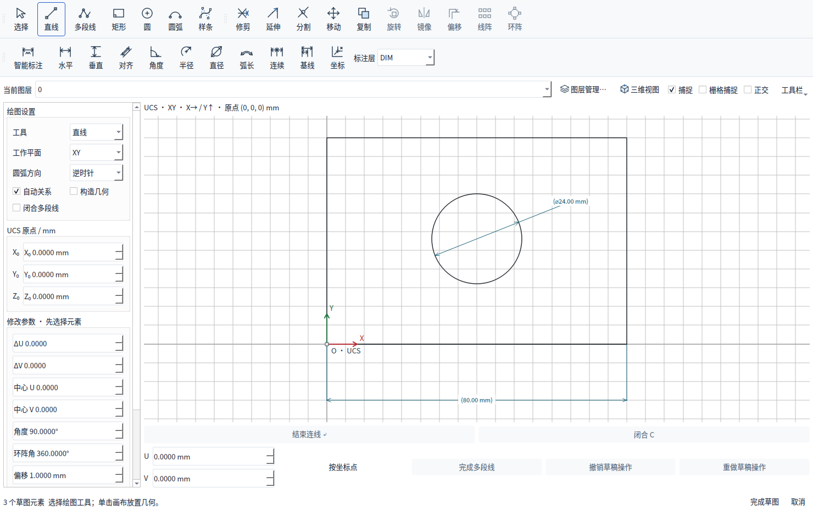
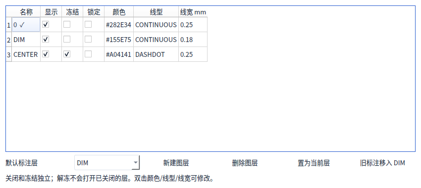
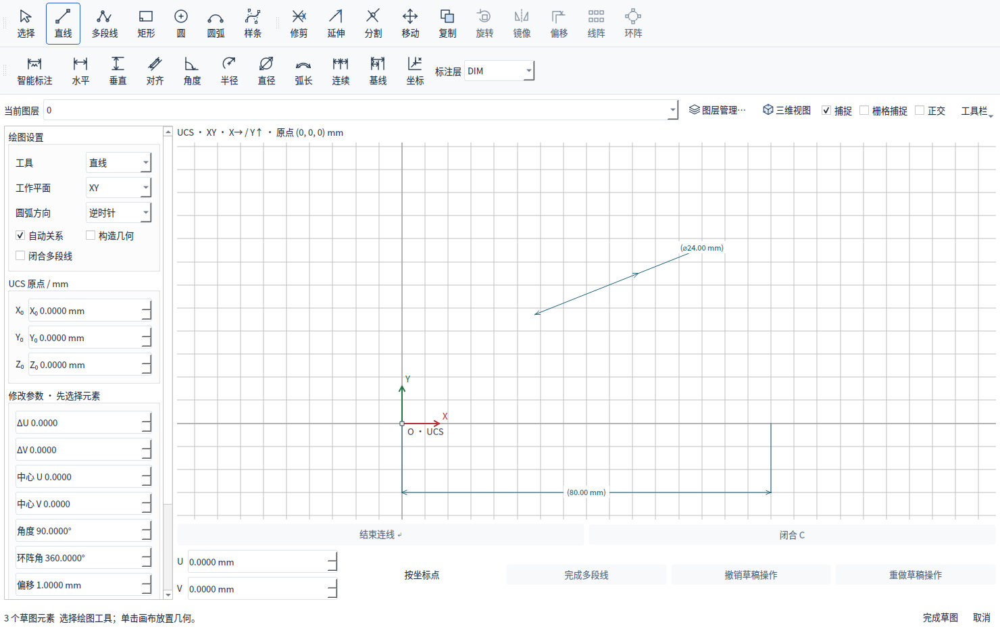

# DIM 图层实现验收记录

已实现新尺寸默认 DIM、可选标注层、整张图纸非模态图层管理、独立显示/冻结/锁定、旧标注迁移，以及保存重开、交错撤销/重做和原生 DXF 状态交换。当前层不能冻结；关闭层仍计入范围，冻结层排除；隐藏几何不隐藏独立标注，隐藏/冻结不解除驱动约束。

## 验证

- 全量 pytest：1854 通过、9 处旧命令清单/分类预期失败；已更新预期并完成定向复测，全部已解决。
- 命令库/集成复测：27 通过，剩余 1 处插件分类预期修正后单独通过；CLI 复测 10 通过。
- 最终图层 UI：11 通过；相关画布回归 34 通过；求解与 DXF 回归 124 通过。
- 全量格式和严格类型检查通过；lint 的一处无用测试导入修正后通过；后续改动的 lint、格式、类型检查均通过。
- 独立审查问题和新增历史分支、标注范围问题均保留失败到通过的测试证据，见 review.md 与相应日志。

## 界面

当前已运行的 MyCAD 进程未在本次实现期间重启，重新启动后加载新代码。当前工作区保留原有未提交内容，未执行提交、合并或推送；用户视觉验收仍待复验。
