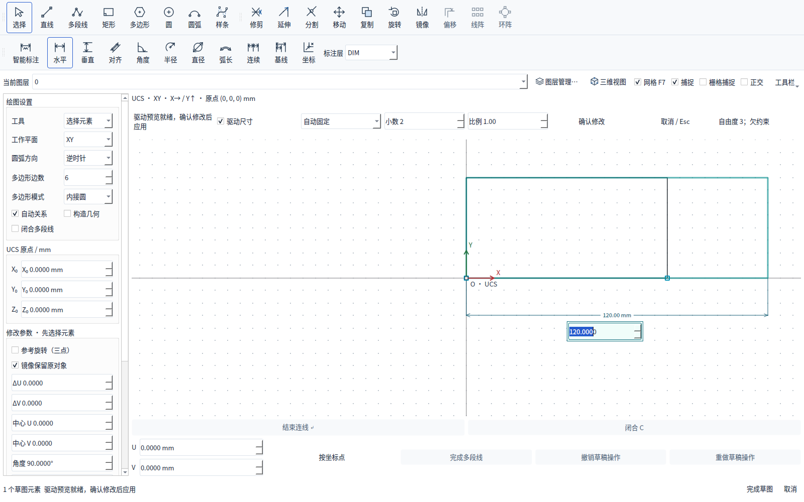
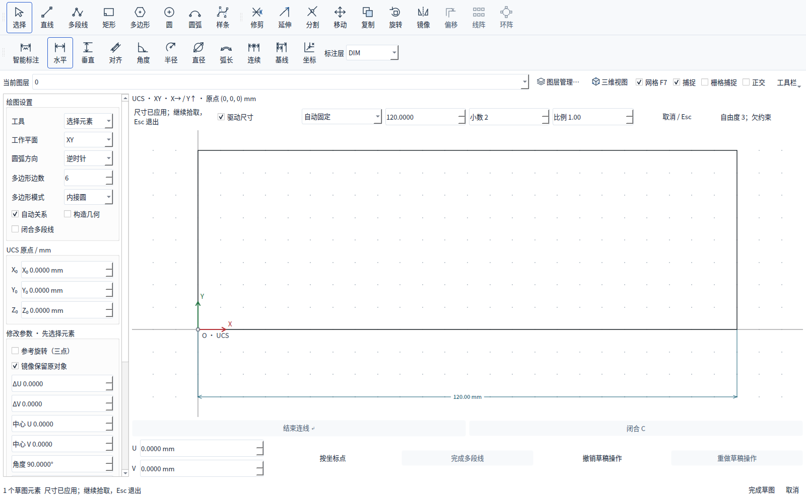
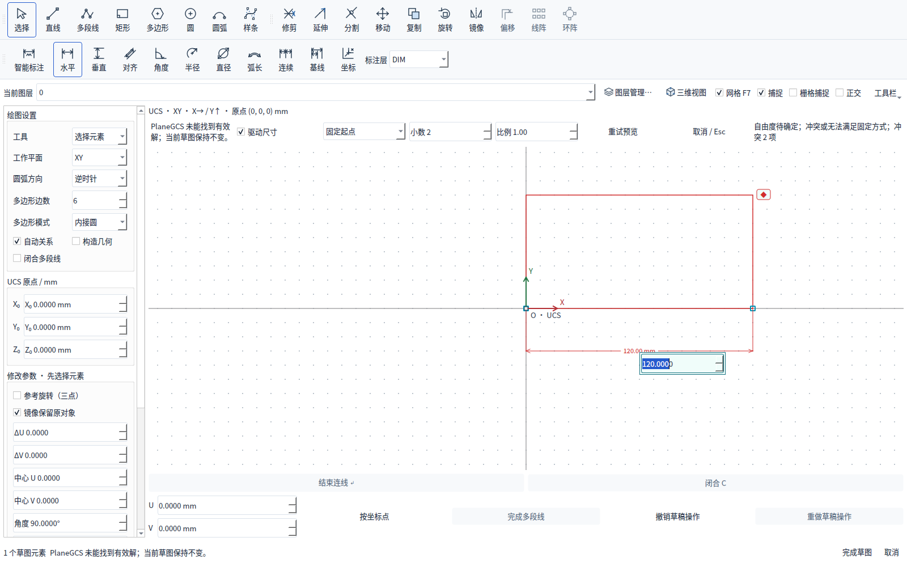

# 图内驱动尺寸验收记录

已实现新尺寸默认驱动，保留参考切换和既有参考尺寸转驱动。水平/垂直及坐标投影方向已修复，线性尺寸可选自动、固定起点、固定终点、中心对称。自动优先遵守已有固定/锁定关系；固定方式仅用于当前编辑定位，不增加永久固定约束，界面自由度按持久约束计算。

尺寸旁输入、几何与标注同步预览、Enter 确认、Esc 取消；确认后收起输入框并返回画布。冲突图元和尺寸标红且保持原图。DIM 归属、位置、稳定身份、撤销重做、已提交 Bus 更新和存档重放均保留。

## 验证

- 全量 pytest：**1927 passed**，0 失败，517.77 秒。
- 全量 ruff：通过；格式：352 文件通过；严格类型：0 错误、0 警告；diff check：通过。
- 独立审查的两处界面问题均已复现并修复，测试保留失败到通过证据，见 review.md。
- 旧 Qt 悬停测试在首次光标位置未变化时可能不收事件，已在测试中通过真实移动到另一位置后再检查消除顺序依赖；最终全量通过。

## 界面走查

范围为单个草图内的关联图形；跨草图约束和变量公式后续扩展。现有存档使用冻结解重放，不被新求解策略改写。未重启当前 MyCAD，重启后加载本次更新；保留当前工作区前置未提交内容，未执行提交、合并或推送。
