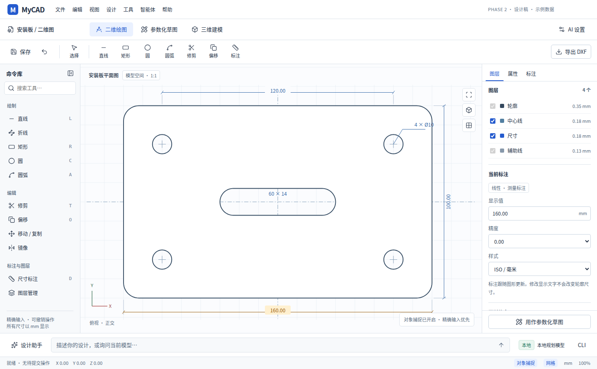
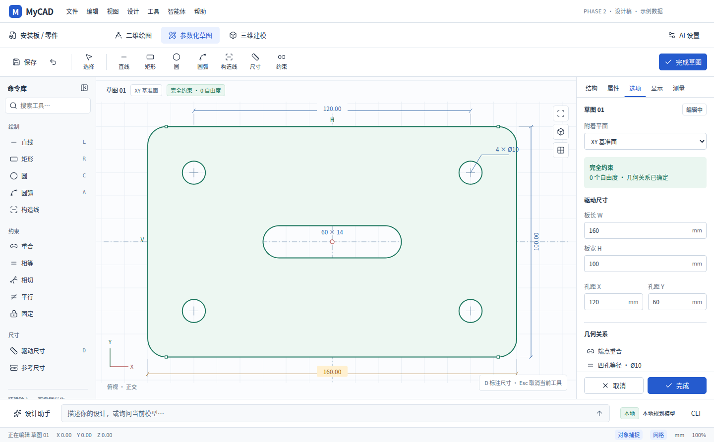
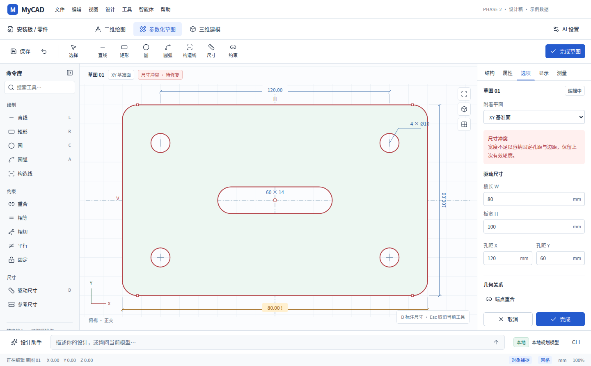
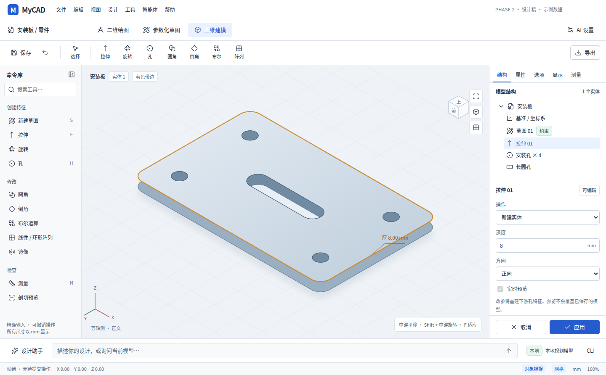

# Phase 2 UI 设计方案：明亮专业 CAD 工作台

## 2026-11-04 双参考路线与启动首页（优先适用）

[全应用统一设计](design/2026-11-04-unified-ui-design.md)及[整改 TODO](design/2026-11-04-unified-ui-todo.md)接替本文件的冲突布局规则。启动首页提供二维图、工程图、三维零件、三维装配四入口，装配当前明确暂不可创建。独立二维图参考 **AutoCAD**；零件/零件内草图/工程图参考 **Solid Edge ST10**。共同主题和文件基础可复用，命令输入、导航、快捷键和布局按环境设计。

下文与 HTML/PNG 保留为历史设计资产；“左命令库、右结构树”等旧共同布局不再是统一整改的目标。独立二维已有工具和交互须保留并按 AutoCAD 专项改进，不能被三维改版连带替换。本轮只落盘设计和清单，不声称新 UI 已实现或已验收。

## 2026-11-02 三维建模交互补充

原视觉稿不包含完整坐标系/基准建模交互，不能作为这些能力的完成证据。新增[三维建模基础框架修订](superpowers/specs/2026-11-02-3d-modeling-foundation-design.md)作为操作规格补充：建立独立零件草图工作台及工具栏、选择状态、草稿和编辑会话，不依赖二维编辑窗口；在零件三维场景内编辑平面草图，锁定支撑并支持正视/旋转；坐标系与基准平面在模型树中可选择、显示和编辑；输入坐标系、草图支撑及孔来源 U/V 分别标示。

共享候选拾取/捕捉服务用于草图及 E3-B 孔定位，提供对象捕捉、U/V 或 XYZ 数值、独立栅格开关，显示与拾取始终对应同一模型状态。非共面空间草图另设模式及验收。此补充为待实施设计，不修改历史 HTML/PNG，也不将自动化测试替代真实桌面验收。

| 项目 | 内容 |
| --- | --- |
| 版本 | v0.2 · 阶段范围拆分；视觉资产仍为 v0.1 |
| 日期 | 2026-10-23；原设计稿 2026-10-22 |
| 状态 | 明亮视觉方向已获用户积极反馈；操作规格与产品实现仍待评审验收 |
| 已确认范围 | 明亮工作台、独立二维绘图、基础参数化草图、常规三维建模及可靠性；AI、企业与数据库扩展移至 Phase 3 |
| 关联任务 | [phase2 Todo](../.omo/plans/phase2-agent-loop.md)，重点 P2-28～P2-37、P2-44；既有确认缺陷见 P2-20 |
| 现有基线 | [UI 设计初稿](UI设计初稿.md)、[需求分析书](需求分析书.md)、[技术路线](技术路线.md) |
| 本次变更边界 | 拆分设计规格与计划追踪；不修改已有 HTML/PNG；不修改应用源码、测试、依赖、现行 ADR 或阶段 1 基线文档 |

## 1. 查看设计稿

- [可交互预览](design/phase2-workbench-v1/preview.html)：历史合并概念稿，可切换三工作区；右上角 AI 设置属于 Phase 3。
- [二维绘图](design/phase2-workbench-v1/01-drawing.png)
- [参数化草图](design/phase2-workbench-v1/02-sketch.png)
- [三维建模](design/phase2-workbench-v1/03-model.png)
- [Phase 3 · AI 服务连接](design/phase2-workbench-v1/04-providers.png)
- [Phase 3 · 模型管理](design/phase2-workbench-v1/05-models.png)
- [Phase 3 · 任务默认值](design/phase2-workbench-v1/06-task-defaults.png)
- [Phase 3 · AI 计划确认](design/phase2-workbench-v1/07-ai-plan.png)
- [草图尺寸冲突](design/phase2-workbench-v1/08-sketch-conflict.png)
- [Phase 3 · 模型服务认证失败](design/phase2-workbench-v1/09-provider-error.png)

原型采用同一安装板示例：外形 160 × 100 mm、外角 R8、厚度 8 mm，
4 × Ø10 安装孔、孔距 120 × 60 mm、中央 60 × 14 mm 长圆孔。
二维、草图和三维的设计语义可直接对照。

所有图形、模型 ID、验证结果和服务状态都是设计示例；原型不接 CAD 内核、不请求 LLM、
不读取凭据、不保存真实配置。示意尺寸不构成制造图纸，显示的预览不构成几何校验。
preview.html 是独立的离线评审文件，不是应用前端迁移方案。

## 2. 视觉目标与信息层级

“明亮、安静、精确”：画布承担主要视觉面积，工具可发现，参数可读，
选择与预览突出，错误就近出现。日常建模不依赖阅读技术命令 ID。

保留五区结构和项目约定的左右分工：

1. 顶部：菜单、文档身份、工作区切换、上下文工具栏。
2. 左侧：可检索命令库，按当前工作区分组。
3. 中央：几何与标注，局部视图控制。
4. 右侧：结构、属性、当前操作、显示与测量。
5. 底部：紧凑助手入口、按需展开的计划/CLI，以及独立状态栏。

AI 设置是应用级设置页，位于右上角；它不是第四种几何编辑模式。
设计稿顶部切换可用于评审不同场景；正式产品只允许在适用的文档/编辑上下文切换。
从独立二维图进入参数化草图，必须通过“用作草图”等明确动作，不因切换标签自动转换数据。

### 2.1 候选设计令牌

| 用途 | 候选值 | 使用规则 |
| --- | --- | --- |
| 三维画布 | #EFF3F7 | 明亮冷灰；模型背光面仍需清晰 |
| 二维/草图画布 | #FBFCFE | 接近白色，细网格低对比 |
| 面板 | #FFFFFF | 参数区域保证稳定对比 |
| 次级面板 | #F7F9FB | 命令库、状态区有轻微层次 |
| 分隔线 | #DCE3EB | 1 个逻辑像素；不以粗边框分割所有内容 |
| 主文字 | #243247 | 中文与数字使用同一清晰层级 |
| 次级文字 | #586B80 | 标签、说明、单位仍需可读 |
| 主操作/焦点 | #255BCE | 每个操作区域突出一个主要动作 |
| 激活底色 | #EAF1FF | 工作区、当前工具、树节点 |
| 选择边界 | #D98A22 | 配合对象名称；不与错误或求解状态混用 |
| 成功/已约束 | #17735A / #EAF6F0 | 同时出现文字或符号 |
| 待确认/警告 | #9D5A06 / #FFF4DD | 说明阻塞原因及下一动作 |
| 错误 | #B13C42 / #FFF0EF | 定位对象/字段，保留原输入 |

Qt 整数颜色与 GL 归一化颜色必须在适配边界转换；不能复用同一元组而省略约定。
E08 的背景转换错误须在 P2-28 修复，本设计稿不会修复实际应用。

字体候选为 Noto Sans CJK SC / 系统中文无衬线；正文 13 个逻辑像素、
次级信息 11～12、面板标题 12～13、设置页标题 22。
参数数字采用等宽数字；无单位的裸数值不得用于有单位参数。
正文及必要说明以 4.5:1 对比为检查目标；约束与选择还需文字/形状辅助。

图标统一使用细线矢量样式，常用 16～19 个逻辑像素。按钮圆角 4～6，
面板主体保持平直，不增加大圆角、大片装饰色块或持续动画。
本原型使用 Lucide 图标；正式 Qt 集成时还需确认资源分发和许可证保留方式。

### 2.2 尺寸、布局与适配

| 部位 | 桌面候选尺寸 | 行为 |
| --- | --- | --- |
| 菜单/品牌行 | 46 px | 保持完整功能入口 |
| 文档/工作区行 | 50 px 左右 | 当前文档与当前编辑模式明确 |
| 上下文工具栏 | 58 px | 文件/历史、选择、当前工作区高频工具分组 |
| 左命令库 | 194 px，窄屏 162 px | 可收起；文本搜索可发现所有已支持工具 |
| 右检查面板 | 278 px，窄屏 248 px | 内容区滚动；应用/取消固定在底部 |
| 命令行高 | 34 px | 可评审 30～42 px 密度 |
| 底栏收起状态 | 按已有 CLI/计划入口确定 | 默认避免空白占画布；新助手输入与模型入口归 Phase 3 |
| 状态栏 | 29 px | 操作提示、选择/坐标、捕捉、网格、单位 |

以上为逻辑像素设计值，不是 Qt 物理像素常量。DPI 变化要重新核对图标、
命中半径、标注字号与焦点，而非仅将整个截图缩放。

1920×1080 为主要目标，1366×768 为紧凑桌面目标；关键应用/取消操作始终可达。
小屏先收起左栏、折叠说明，保留参数输入。桌面应用的最小尺寸需在 Qt 原型阶段定标。
本评审预览在更窄宽度会将右面板移至画布下方，方便聊天内查看；
该行为不是当前阶段承诺提供手机 CAD 产品。

## 3. 独立二维绘图

### 3.1 画面与操作

- 白色模型空间；轮廓深灰蓝、中心线细点划、尺寸蓝色，选中尺寸用琥珀色。
- 视图保持工作平面的正交投影；可见原点/坐标方向，网格与捕捉独立开关。
- 工具栏：选择、直线、矩形、圆、圆弧、修剪、偏移、标注。
- 左栏补充折线、延伸、分割、移动/复制、旋转、镜像、阵列及图层入口。
- 右侧二维专用页为“图层 / 属性 / 标注”，沿用右栏职责，避免出现无关实体特征树。
- 图层列出显隐、名称、颜色、线宽；正式实现增加锁定、线型及当前层状态。
- 标注面板显示类型、实际值、精度和样式；测量标注与驱动尺寸具有明确标签。

### 3.2 主要流程

新建二维图 → 确认单位 → 绘制/捕捉 → 输入精确尺寸 → 编辑轮廓 → 标注/图层 →
保存 → DXF 导出与兼容性报告。

连续绘制时：点击确定点，Tab 切换当前数值字段，Enter 完成当前输入，
Esc 先取消当前段，再退出工具；不为每次鼠标移动创建历史记录。
正式快捷键需确认与输入法、菜单及已有快捷键的冲突。

“用作参数化草图”需选择目标零件与平面，并显示复制/关联策略。
首批建议复制选中闭合轮廓，保留原二维图；未来关联更新必须另有依赖契约。
设计稿按钮只演示复制后的场景切换。

### 3.3 状态与边界

| 状态 | 反馈和动作 |
| --- | --- |
| 空图 | 显示单位、原点和“直线 / 矩形 / 导入 DXF”入口 |
| 未闭合轮廓 | 高亮断点；可继续绘制，不误报可拉伸 |
| 自交/退化边 | 定位几何；保留可编辑状态 |
| 图层锁定 | 可见但不可编辑，提示锁定层名称 |
| DXF 未知单位 | 导入前要求明确单位 |
| DXF 不支持实体 | 列出类型与数量，允许取消或明确导入支持部分 |

首批 DXF 子集的准确范围由 P2-35 锁定；本设计稿不承诺完整 CAD 文件兼容。
独立二维图不自动具有三维投影、剖视和尺寸关联工程图语义。

## 4. 参数化草图

### 4.1 画面与操作

- 顶部明确“正在编辑草图 01”和附着平面。
- 已约束几何为绿色，未约束几何为蓝色，冲突对象红色；与文字/自由度共同表达状态。
- 工具栏将“构造线 / 尺寸 / 约束”提升为高频入口；右上角“完成草图”始终可见。
- 右侧顺序：草图身份与平面 → 求解状态 → 驱动尺寸 → 几何关系。
- 右侧底部固定“取消 / 完成”；参数区域滚动不遮挡结束操作。
- 默认显示必要约束，密集约束按选中对象展开；点选冲突信息定位相关几何和尺寸。

### 4.2 参数和确认

用户输入尺寸 → 本地草稿求解 → 显示几何与状态 → 完成草图 → 经确认语义提交 →
下游特征重建。取消恢复进入编辑时的状态。

参数化草图中的尺寸可驱动几何；参考尺寸只读。自动捕捉产生的推断关系要明确显示，
允许用户取消该推断，避免无意施加约束。
充分约束不等于解唯一；未来求解器仍需检测解分支翻转、退化和外部引用失效。

原型可将板长改为 80 mm 展示尺寸冲突，再恢复 160 mm。
该冲突仅是针对示例固定孔距与边距的界面演示，不是约束求解器。
尺寸冲突时不能“完成”，需要修复或取消。

### 4.3 草图验收要求

1. 欠约束、完全约束、冲突和求解失败均有可辨的文字与对象定位。
2. 驱动尺寸变更可预览，取消不会修改已提交草图。
3. 完成后相关拉伸/旋转按同一设计意图重建。
4. 改动的尺寸及约束可保存、撤销、重开；不能只保存屏幕图形。

## 5. 三维建模

### 5.1 显示规范

默认浅灰画布、银灰实体、柔和填充光；同时可辨顶部、侧壁、孔壁与圆角。
边界线来自几何边界策略，内部三角对角线不出现在普通着色模式。
主视图显示坐标轴、标准方向与适应窗口入口；正交/透视状态可见。
“着色 / 着色带边 / 工程线框 / 网格诊断”分别定义，不混用。

悬停显示细预选边，点击后选中边为琥珀色，右侧同步对象身份。
预览对象采用清楚的专用样式，状态栏显示“预览中”；提交结果与预览必须一致。
原型中的模型是矢量示意，其侧壁/孔壁效果只表达视觉方向，不替代真实 GL 验收。

### 5.2 结构与参数

结构树按基准、草图、特征、实体区分来源与当前对象；选中特征后，
可在结构页下方看到关键参数，详细编辑进入“选项”。保持对象名可改、技术 ID 可查。

拉伸操作顺序：选择轮廓 → 操作类型（新建/合并/切除）→ 方向/深度 →
预览 → 应用。下游影响在操作区说明，失败定位到特征并恢复原状态。

“应用 / 取消”固定在右侧底部。手工输入作为明确操作确认，经 Bus 提交；
此确认语义须由 P2-00/P2-31 落实，不能在 UI 中另建写模型入口。

### 5.3 常规操作入口

| 工具组 | 第一批 | 后续范围 |
| --- | --- | --- |
| 创建 | 新建草图、拉伸、旋转、孔 | 扫掠、放样按场景决策 |
| 修改 | 圆角、倒角、布尔 | 抽壳、拔模按有界原型决策 |
| 复用 | 复制、镜像、线性/环形阵列 | 特征阵列与实体阵列分别定义 |
| 检查 | 尺寸、距离、角度、体积、有效性 | 剖切预览需独立显示/选择契约 |
| 交换 | STEP/STL 导出 | STEP 导入按 Phase 3 的 P3-18 决策 |

原型命令库展示预期信息架构；只有若干代表交互可演示，不能据按钮存在判断工具已实现。

## 6. 既有计划卡片与手工确认

Phase 2 保留阶段 1 的计划编辑/确认入口，并按 P2-20 修复内容与文档修订绑定。
手工绘图使用当前工具的应用/完成动作；预览、Esc 取消与撤销语义一致。
不在本阶段新增模型配置、网络请求或对话生成。新 AI 界面详见 [Phase 3 方案](phase3-扩展设计方案.md)。

## 7. 跨阶段原型说明

原 v0.1 可交互稿及九张画面原样保留，既有评审记录不重写。
其中 AI 设置、模型管理、任务默认值和新 AI 计划生成均属于 Phase 3；
Phase 2 实现时只呈现已可用的基础入口，不能用未实现的按钮占位表示交付。

## 8. 历史合并原型的交互覆盖与限制（不等于 Phase 2 范围）

| 可交互评审内容 | 原型表现 |
| --- | --- |
| 三工作区 / AI 设置切换 | 改变上下文工具、画布、右栏内容 |
| 命令搜索 | 过滤当前工作区命令 |
| 网格、二维尺寸/中心线 | 控制示意图层显隐 |
| 三维厚度 | 修改预览、应用、取消、示例撤销 |
| 草图宽度 | 更新示意；80 mm 显示冲突，160 mm 恢复 |
| 草图完成 | 有冲突时阻止，正常时返回三维场景 |
| AI 服务选择 | 本地配置与云端配置表单 |
| 测试连接 | 模拟本地成功/云端认证错误，无网络调用 |
| 模型验证/默认配置 | 示例能力状态与任务配置页 |

仅提示流程的入口包括复杂绘图/建模工具、真实导入导出、实际保存、
添加连接/模型的完整表单及完整相机拖动。部分参数控件只展示信息层级。
右侧“属性/标注”等复用示例内容，尚未覆盖所有选中类型；这些不算产品功能交付。
正式空文档、持久化失败、引用修复等后续按 P2-29/P2-44 扩展专门设计与验收。

## 9. 与现有实现的边界

- 原型的浏览器表现只用于评审；应用仍为 PySide6 桌面路线。
- 现有左右分工、Bus 写入、确认红线、core/geom/ui 分层和存档兼容约束保留。
- 新增几何边界、选择身份和测量 DTO 仍需独立设计，不能把本稿的矢量点当作内核数据。
- 保留命令 ID、受限草图能力、执行单元与持久化演进按 Phase 2 对应任务先决策；网络/数据库依赖交 Phase 3。
- UI 初稿中的阶段 1 文字按钮/占位、底栏默认 20%～25% 等不再作为 phase2 最终目标；
  用户评审后的新规范再转为实现基线。本文件没有改写现有基线哈希或 ADR。

## 10. 评审与后续验收

本阶段重点评审整体亮度与信息密度、三个工作区的工具组织、参数操作的连贯性及失败恢复。评审修改应记录版本及具体画面，不以零散口头意见替代基线。

| 项目 | 设计稿交付状态 | 产品验收仍需 |
| --- | --- | --- |
| 明亮主题 | 已提供候选令牌及画面 | Qt/GL 实际颜色、法线、灯光、显示器表现 |
| 二维绘图 | 已提供画面及基本交互示例 | 真实图元、捕捉、编辑、DXF 与单位往返 |
| 参数化草图 | 已提供尺寸/求解状态设计 | 真实约束求解、自由度、重放与引用 |
| 三维建模 | 已提供结构/预览/应用设计 | 真实选面选边、参数化特征、失败恢复 |

本次浏览器渲染与交互检查记录见
[设计稿 QA](design/phase2-workbench-v1/QA.md)。它不替代真实 GPU、Qt 高 DPI 或最终用户验收。
2026-10-25：按用户确认，P2-28–31 在 F 的三维工作台范围完成工程收口；真实二维/草图随 G 联验，最终人工体验待用户确认。实现与 Qt/GL、高 DPI 证据见 [F 收口记录](../.omo/evidence/task-P2-F-closure.md)。

## 11. 竞品研究后的交互细化建议

日期：2026-10-22。根据用户提出的 Solid Edge / FreeCAD / AutoCAD 借鉴及 Linux
市场定位，补充下一轮交互规格。详细来源、取舍、成本及对标方案见
[Phase 2 Todo 的竞品借鉴与 Linux 首发范围建议](../.omo/plans/phase2-agent-loop.md)。
本节没有改动 HTML 原型和九张画面，不把行为规格写入等同于交互已经实现。

### 11.1 保持一套操作逻辑

工具栏、命令库、选中对象后的就近动作都进入同一当前任务：选择对象/基准、输入参数、
预览、应用。右侧固定主要操作位置，显示尚缺哪些输入；输入框拥有焦点时，
Enter 先按该字段/工具语义处理，不能触发另一个全局动作。
Esc 取消当前输入/段或退出工具时，提示层次明确；已提交内容通过撤销处理。

光标附近的精确输入和右栏共享草稿值，不各自持有一份参数；字段显示单位及绝对/相对模式。
捕捉标记显示端点、圆心等名称；临时对齐与永久草图约束采用不同提示，后者可取消。
网格、捕捉、正交三种状态分别可见，不因画布出现网格就暗示开启捕捉。

### 11.2 选择、参数和问题要能追溯

- 重叠选择显示候选类型、名称、来源特征，悬停预选，点击确认。默认拾取只测试当前模型快照；
  命中先选择当前模型整体，不依据快照序号推断命令来源。隐藏/遮挡选择必须通过明确模式，
  历史快照不进入默认候选。
- 点击结构树特征行进入明确的历史预览，以该命令执行后的完整模型状态替换当前视口；
  状态栏标明预览 ordinal，“视图 → 返回当前模型”退出。预览期间禁用当前模型拾取，
  避免把历史命中误当成活动模型选择；刷新模型后回到最新状态。
- 关键参数表聚合原特征的数值、单位、来源和影响范围；点击行可定位特征并编辑。
  首版不引入公式编辑器或电子表格；表格值保持来源唯一，提交仍经 Bus。
- 草图冲突和特征重建失败提供相关对象定位、修改与取消入口。保存最后有效模型，
  同时明确它与失败预览的区别；不承诺自动找到最小冲突集。
- 人工修改显示本次变化和保持项；Phase 3 AI 复用同一规范。保持项分为已验证、失败、未验证，
  不将计划文本中的承诺显示为完成检查。

### 11.3 扩展交互归属

参数拖柄、模板选择页的具体规格已迁入 [Phase 3 扩展方案](phase3-扩展设计方案.md)，对应 P3-53。
本阶段关键参数表、数值输入、预览与普通历史编辑完整保留。

### 11.4 Linux 首发体验

下一轮验收增加真实中文输入、中文路径、鼠标滚轮/中键、键盘焦点、缩放比例及
实际 Wayland/X11 覆盖记录。桌面配置缺失时应有可理解的诊断，而非只留下终端堆栈。
Linux 试用分发包已迁至 Phase 3 的 P3-52；P2-25/P2-26 继续验证干净源码安装与实际桌面，
不把浏览器原型适配或开发者源码安装当作用户安装体验的验证。

## 12. 后续企业与数据库扩展

PLM、CAPP、CAD 项目 Git、编码规则及数据库配置统一见 [Phase 3 扩展方案](phase3-扩展设计方案.md)。
默认数据库为 MySQL、达梦。相关契约、连接配置与双库适配都不作为本阶段实现或验收条件。
Phase 2 无企业系统、模型服务或数据库连接时即可完成基础设计任务。
