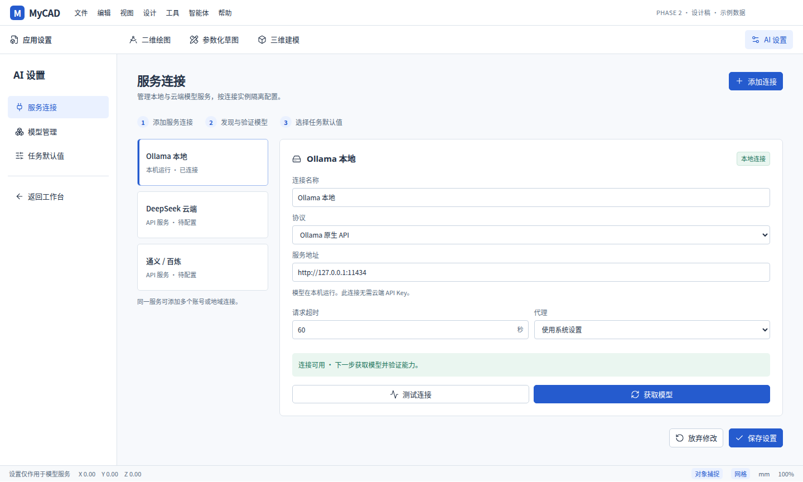
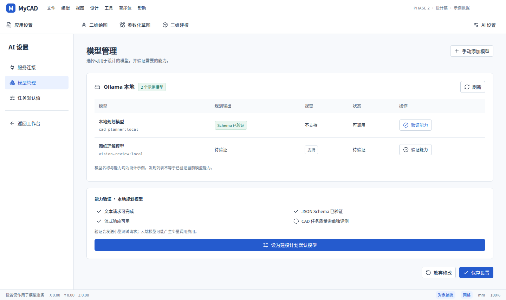
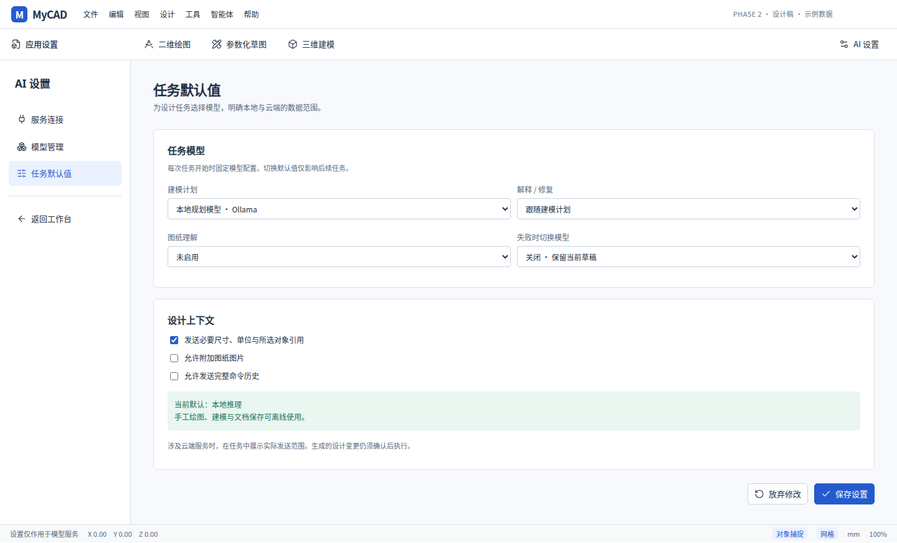
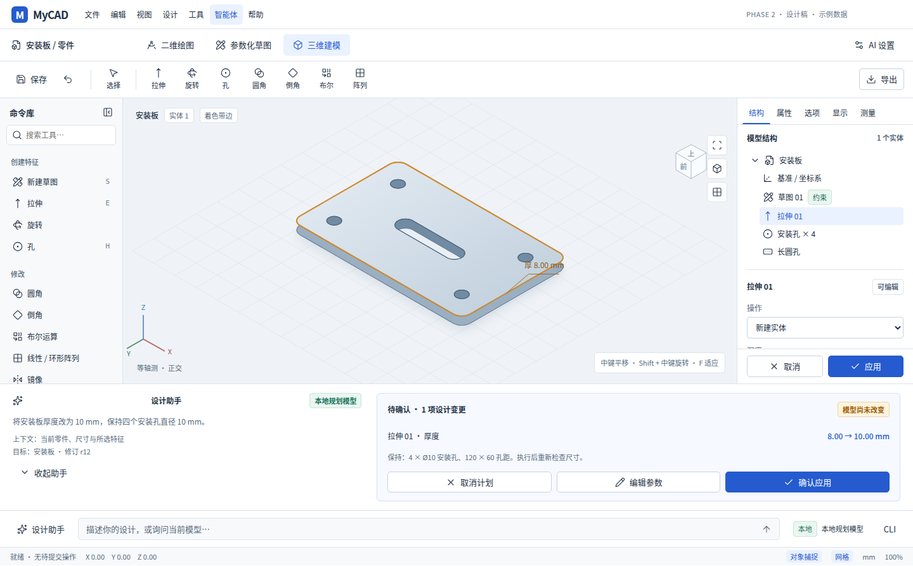

# Phase 3 扩展设计方案：AI、企业与数据库配置

| 项目 | 内容 |
| --- | --- |
| 版本/日期 | v0.1 · 2026-10-23，沿用 2026-10-22 已有 AI 视觉资产 |
| 状态 | 规划规格；未实施代码、未接入任何服务；数据库设置尚无新画面 |
| 关联计划 | [Phase 3 Todo](../.omo/plans/phase3-extensions.md) |
| 基础界面 | [Phase 2 明亮工作台](phase2-UI设计方案.md)，共享主题、输入/预览、状态与错误规范 |
| 默认数据库 | MySQL、达梦；两者均需真实适配和验收，未配置时手工 CAD 完整可用 |

## 1. 设计资产与交付边界

[原 v0.1 合并概念稿](design/phase2-workbench-v1/preview.html) 原样保留，目录名不代表阶段交付归属。
AI 配置及计划示意已从 Phase 2 迁入本文件；浏览器原型不接内核/网络、不保存凭据或真实配置。
既有 [QA 记录](design/phase2-workbench-v1/QA.md) 是历史视觉/交互证据，不等于 Qt 或真实系统兼容验收。
企业与数据库部分本轮仅提供规格，不宣称已有相应画面或可运行控件。

## 2. AI Provider / Models 配置

### 2.1 服务连接页

设置入口：工具 → 选项 → AI，或右上角 AI 设置，或底部当前模型入口。
左侧为“服务连接 / 模型管理 / 任务默认值”；返回工作台应恢复当前文档与选择。

服务连接页采用“连接列表 + 当前连接表单”：

| 字段/动作 | 规格 |
| --- | --- |
| 连接名称 | 用户可识别的实例名称，同厂商可有多个 |
| 服务/协议 | 首批模板 DeepSeek、通义、Ollama；自定义 endpoint 按协议适配 |
| 地址/地域 | 明确目标；按 provider 显示地域或 workspace |
| API Key | 本地无需时隐藏；云端密钥录入/替换，保存后只显示掩码 |
| 超时/代理 | 合理默认；高级项可折叠 |
| 测试连接 | 未检测/检测中/可达/认证失败/超时；不得宣称模型能力已验证 |
| 获取模型 | 跳到模型管理；无发现接口时提供手动添加 |
| 保存/放弃 | 草稿设置与当前生效配置分开；切页未保存时有明确选择 |

真实凭据由操作系统凭据存储保存；无存储能力时显式提供会话临时配置或环境变量方式。
连接地址变更会使已有验证状态失效。认证失败就近显示原因和可修复入口，不弹泛化错误。
原型云端地址使用 models.example.com 占位，密码框只读，不应输入真实密钥。

### 2.2 模型管理页

每个模型隶属一个连接实例，列表展示友好名、真实模型 ID、规划输出能力、视觉、状态和验证动作。
详细属性包含上下文/输出限制、流式、工具调用、JSON object、JSON Schema、
最后验证时间与证据来源；未知能力明确显示“待验证”。

模型列表可搜索、按连接筛选、刷新和手动添加；详情与能力验证留在同页。
首轮稿重点展示一条本地连接中的两个示例模型，其他连接复用同一结构。
cad-planner:local、vision-review:local 是示例 ID，不是推荐下载或已验证存在的模型名称。

验证层级分别显示：

1. 服务可达及认证通过。
2. 指定模型能完成请求。
3. 当前协议下所需能力通过验证。
4. MyCAD 设计任务通过独立评测。

验证按钮说明会发送测试请求；付费服务提示可能产生少量调用费用。
刷新/验证期间保持列表和已选模型，失败不会清空用户手动配置。
API 返回的列表元数据不能自动替代能力探测。

### 2.3 任务默认值

- 建模计划：必需一个可用文本/结构化计划路线。
- 解释/修复：默认跟随建模模型，可显式覆盖。
- 图纸理解：默认关闭，配置具备视觉能力的模型后可启用。
- 失败切换：默认关闭；若启用，切换目标、云端范围与提示策略明确。
- 上下文：尺寸/单位/选择引用按任务需要；图片、完整命令历史分别控制。

任务开始时固定实际 provider/model/config；全局设置变更只影响后续任务。
设置导出默认去除凭据；模型/连接删除前提示受影响的默认值和进行中任务。

### 2.4 状态矩阵

| 情况 | UI 反馈 | 可继续动作 |
| --- | --- | --- |
| 尚未配置 | 底部“配置设计助手”，手工工作区正常 | 配置或继续手工设计 |
| 模型发现不支持 | “此服务需手动添加模型” | 输入模型 ID |
| 模型能力未知 | 待验证标签，不显示虚假的支持图标 | 验证或选择已验证模型 |
| 认证失败 | 表单附近错误，保留输入 | 更换凭据、检查地址 |
| 限流/额度不足 | 区分两种原因，展示可重试时机 | 有界重试或取消 |
| 本地服务离线 | 显示连接不可达，保留模型列表 | 启动服务后重试 |
| 输出为空/截断 | 保留用户请求，提示计划未完成 | 重新生成，不执行部分内容 |
| 切换文档/取消任务 | 停止显示旧请求的迟到结果 | 在新上下文重新生成 |

## 3. 底部助手与计划确认

收起时只显示输入入口、当前连接/模型和 CLI 入口；展开后调整画布高度。
左侧保留用户意图与上下文摘要，右侧显示具体变更、保持条件和执行动作。

示例：“厚度 8 → 10 mm，保持四个 Ø10 安装孔和孔距”。
卡片明确“模型尚未改变”，并提供取消、编辑、确认应用。
编辑计划参数后重新等待确认；执行完成或取消后，旧确认按钮失效。
文档修订变化时提示计划已过期，重新生成/校验，禁止直接使用旧确认。

正式产品应将计划执行状态映射到既有六态机；本稿不新增与 core 不一致的业务状态机。
动作显示可用中文文案，但底层确认仍绑定具体计划内容和目标文档修订。

## 4. 企业用户定位与集成信息预留

用户已明确 MyCAD 主要服务企业用户。产品将企业关联信息融入文档与项目上下文，
保持原工作区的操作效率；本轮仅补充规格，未修改原型或应用。
接口细节与设计任务见 Phase 3 Todo 的“企业定位与集成接口预留”和 P3-45～P3-47。

| 区域 | 预留信息/动作 | 首阶段边界 |
| --- | --- | --- |
| 顶部文档身份 | 企业项目、零件/文档编码、名称、业务修订、本地保存状态 | 临时编码显式标记；业务修订与 Git 提交分开显示 |
| 项目/属性面板 | PLM 对象链接、材料来源、CAPP 工艺引用、Git 状态 | 展示信息来源与同步时间；未连接/离线未知不显示成已发布 |
| 应用设置 | “企业集成”：PLM、CAPP、版本库、编码规则与策略来源；“数据连接”管理数据库 | 与 AI provider/models 设置分开；本轮不承诺已支持具体厂商 |
| 交付操作 | 选择冻结版本、检查包内文件、显示目标系统、明确发布、查看回执 | 不把本地保存等同于检入/发布；不构建审批后台 |
| 编码输入 | 校验/预览、申请状态、正式编码来源、规则版本 | AI 不能自拟正式料号；不允许用本地预览冒充全局唯一编码 |
| 版本与差异 | 参数变化摘要、Git 文件版本、PLM 业务状态各自可查 | 文本合并成功仍需几何重放验证；首批不承诺自动三方合并 |

受企业管理的字段按权威来源显示只读/受控编辑；企业授权与用户“确认应用”分别成立。
AI 模型可用范围与数据外发范围预留项目策略输入；无权外发时提供可理解的原因和本地操作路径。
未配置任何企业系统时，工作台仍能离线绘图与建模。

只有在 P3-45～P3-47 完成契约定版、真实适配另行实施并验收后，才能将上述入口标记为可用功能。
设计稿后续可补充这些状态画面，当前九张示意图不构成企业集成完成证据。

## 5. 数据连接：MySQL 与达梦

设置的信息架构分为“常规与工作区”“AI 服务”“企业集成”“数据连接”。
数据库类型不是 AI provider；企业业务关联也不通过数据库设置编辑，避免混用凭据和数据权威。
普通设计流程不强制经过这些配置页；入口可见状态应符合已安装适配器和当前权限。

| 区域 | 字段/动作 | 交互要求 |
| --- | --- | --- |
| 连接列表 | 名称、类型 MySQL/达梦、目标库/schema、状态、最近测试时间 | 同类型可多实例；未配置不提示 CAD 不可用 |
| 连接表单 | 地址、端口、库/schema、账号、凭据引用、TLS/证书、超时/池容量 | 按适配器显示字段；密码保存后仅掩码，支持安全替换；高级选项折叠 |
| 数据范围 | 企业/项目上下文、当前授权来源、只读/可写能力 | 选择项目不等于获得权限；不得通过手填项目 ID 绕过授权 |
| 测试连接 | 网络、认证、schema 版本、权限、适配器兼容性分项结果 | 使用只读探测；不做初始化、升级或设计上传 |
| 初始化/迁移 | 当前版本、目标版本、变更摘要、备份前提、失败恢复入口 | 独立管理动作；权限不足解释原因，禁止启动时静默 DDL |
| 保存/放弃 | 草稿与生效配置分开；切换/删除连接检查引用和未完成操作 | 不静默切换数据库，不把连接类型切换当成数据迁移 |
| 诊断 | 请求/操作 ID、脱敏错误、驱动/运行库/服务版本 | 不显示口令、完整连接串或未授权记录 |

数据库状态至少区分：未配置、驱动缺失、连接中、不可达、认证失败、权限不足、schema 未初始化、
版本不兼容、可读、可写、事务冲突、提交结果待核对。颜色配合文字和可执行下一步。
达梦 DPI/驱动不匹配时指向部署说明，不诱导用户把 CAD 依赖全部重装。

文档保存与企业登记分别反馈：“本地已保存；数据库登记失败，可重试”。
超时但可能已提交时显示“结果待核对”，先查询操作 ID，再决定是否重试；不能显示明确失败后盲目重复写。
外部状态带设计版本、来源与获取时间；过期索引不显示成当前发布状态。
断开数据库时继续绘图/建模/本地保存；当前设置页错误不能盖住整个画布。

首批配置页只支持 MySQL、达梦两个真实适配入口，不放置无实现的其他数据库选项。
无可用凭据存储时允许明确的会话临时配置，禁止静默改用明文 QSettings。
真实验证绑定版本/平台；“连接成功”“数据操作通过”“迁移/恢复通过”分别记录，不合成一个泛化绿灯。

## 6. 条件性 CAD 交互

参数拖柄仅允许修改能唯一追溯到特征参数的厚度/半径；不能唯一映射时转入参数/测量面板。
拖动预览隔离于已提交模型，松开鼠标不绕过该工具的明确提交语义。
这借鉴直接操作的便利，但本项目仍使用既有历史参数重建。

模板选择页最多先展示安装板与法兰，生成后仍可用普通参数与草图编辑。
它与“用作草图”均必须明确创建/复制的目标，不以切换工作区隐式转换数据。
两项具体成本与准入见 Phase 3 计划的 P3-53；不因写入本节而自动计入已确定的开发周期。

## 7. 扩展验收

| 项目 | 现有规格/资产 | 实施验收 |
| --- | --- | --- |
| AI 配置 | 原三页配置与失败示意 | 凭据、发现/手工添加、能力验证、流式取消与真实路线 |
| AI 计划 | 原编辑/确认示意 | 内容/修订绑定复用 P2-20，生成/校验/执行/查询闭环 |
| 企业关联 | 文本规格，无新画面 | P3-45～47 契约；实际入口只在对应适配实现后开放 |
| 数据库 | 本文件字段/状态规格，无新画面 | P3-48～51 双库真实数据、事务、迁移/恢复、断库路径 |
| 高级交互 | 条件性候选 | P3-53 go/no-go 后才追加实施与画面验收 |

所有新增实现复用明亮主题和键盘/高 DPI 规范；配置权限与日常建模动作分开表达。
本文件只是规划拆分，不修改历史 HTML/PNG，不勾选任何产品实现任务。
