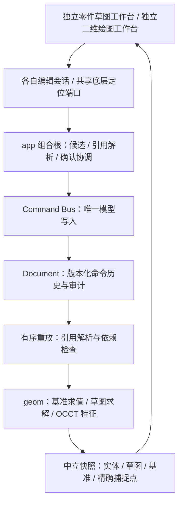

# 三维建模基础框架修订：坐标系、基准平面与场景内草图

日期：2026-11-02。状态：架构设计已转入 M0/M1 开发；v6 档案、候选迁移和基准到关联草图的 API 已接入，最终验证状态见实施计划。M2–M6 仍待实施。

用户要求：参考 Solid Edge 深入分析并补正三维环境草图、多坐标系、辅助平面三项缺口。本文件是此次分析与后续工作包的统一依据；此前 E3-A/E2 的验收结论保留，E3-B 尚处于设计阶段。术语“辅助平面”在模型中称为“基准平面”。

用户进一步明确：**三维操作界面的草图必须与二维绘图独立**。这是已确认的产品组织要求；下文据此采用独立零件草图工作台，不能退化为同一个二维编辑窗口的视图切换。

## 1. 结论与方案取舍

缺口不只是缺少三个 GUI 入口，而是缺少可持久引用的设计空间及其编辑环境。现有工作平面值、选面查询和二维编辑器能支撑局部功能，尚未组成“坐标系 → 基准平面 → 草图 → 建模特征”的完整依赖链。

| 路线 | 收益 | 代价与结论 |
| --- | --- | --- |
| 每个工具各自增加平面、坐标输入和拾取 | 单个按钮较快出现 | 孔、草图、未来扫掠会各有坐标解释，依赖、迁移与失败恢复重复；不推荐 |
| 保留 Bus/重放/内核，统一设计引用与空间上下文，按纵向场景交付 | 复用现有几何及审计，逐步补齐三项基础 | 需要版本化数据契约及编辑器拆分；**本报告推荐** |
| 全面替换建模框架，复刻 Solid Edge 同步建模 | 可重新设计直接编辑体系 | 工作量与验证范围远超三项请求，且无法仅凭公开资料复刻；本轮不选 |

推荐路线是本次分析的技术判断，不冒充用户已作出的实现路线选择。保留 Python/build123d/OCCT、PySide6、Command Bus、纯历史存档和全量重放。暂不更换渲染后端，不新增通用数据库，不把依赖图做成第二份模型真相源。

## 2. Solid Edge 对标：三个概念必须分开

本次查阅 Siemens 官方培训、API 与产品文章。材料包含 ST4/ST7/ST10 历史版本，用于确认已有建模概念，不是 Solid Edge 2026 全功能清单；没有进行 Solid Edge 实机对照，也不据此计算功能覆盖率。以下产品事实与后续 MyCAD 建议分开记录。

| 能力 | 官方资料支持的事实 | 对 MyCAD 的启示 |
| --- | --- | --- |
| 三维环境中的平面草图 | 可在模型面、参考平面或坐标系平面上绘制；支持锁定平面，锁定后不局限于面边界。[S1](#s1) | 保留三维模型作参照，在确定平面内编辑二维参数；不应要求用户离开零件场景 |
| 真正的空间草图 | ST7 引入的通用 3D Sketch 不要求所有元素位于同一平面；定位三轴可相对选定坐标系，支持轴/平面锁定，以及真实尺寸与投影尺寸。[S2](#s2) | 必须有独立的 XYZ 实体与空间约束契约；多张二维草图不能冒充空间草图 |
| 多坐标系 | CoordinateSystems 支持矩阵、几何及相对另一坐标系创建；对象具有名称、方向和偏移能力。[S3](#s3)、[S4](#s4) | 世界坐标、用户坐标、草图局部坐标和视图方向不能混为一个全局状态 |
| 基准平面 | RefPlanes 包含偏置、角度、三点、相切、曲线法向等构造；平行平面还可用参考方向确定面内轴。[S5](#s5)、[S6](#s6) | 平面必须保存构造定义、父引用和面内方向，不能只保存法向或绘制一个矩形 |

Solid Edge 的有序建模与同步建模存在不同的关联/编辑语义。MyCAD 当前采用可重放历史，应先完成有序依赖链；不把同步直接编辑行为作为本次免费附带能力。吸附到关键点、投影复制和建立持久关联也分别验收，不因出现捕捉标记就声称实现关联约束。

## 3. 仓库审计：已有基础与真实缺陷

| 代码入口 | 已有能力 | 本次确认的缺陷 |
| --- | --- | --- |
| `core/sketch.py::WorkPlaneFrame` | 任意方向、正交右手框架；局部 UV/世界 XYZ 转换 | 是数值框架，不是可命名、可编辑、有父引用的模型坐标系/平面对象 |
| `core/sketch.py::Sketch/SketchSupportFace` | 二维实体及约束；frame；平面支持查询 | 支持面按 center/axis/rank 描述；没有持久 datum 支撑，也没有非共面 XYZ 草图实体 |
| `ui/main_window.py::_on_sketch_start/_show_sketch_workbench` | 能选中零件平面启动附着草图 | 编辑器被嵌入二维工作区，不能在实体旁原位绘图。这里使用 workspace-transition guard，不能误称每次都会创建独立草图文档 |
| `geom/kernel.py::_create_sketch` | 重放时解析支持面并重建 frame | 取当前面心/法向重建，几何查询及面心变化无法替代稳定设计引用 |
| `core/viewport_protocol.py` | 中立网格、面/边/顶点及草图显示数据 | 草图 overlay 不可拾取；缺少 datum/坐标系可选对象、精确捕捉锚点契约 |
| `ui/viewport.py::_current_snapshot/selection_target_at` | 已提交模型射线拾取与候选渲染 | 候选显示不等于候选拾取；当前拾取仍取已提交快照，必须显式绑定显示/拾取上下文 |
| `ui/sketch_editor.py` | 二维工具、求解交互、对象/栅格捕捉 | 工具与二维画布耦合；现有私有捕捉候选生成不能直接当三维共享服务 |
| `app.py::ReplayCandidateSession`、`core/bus.py` | E3-A 隔离完整重放、失败前缀、来源校验、一次提交 | 新 datum/草图命令必须加入候选可重放范围、状态恢复及协议，不能仅增加 UI |

补充契约风险：`WorkPlaneFrame.xz()` 的说明写法向 -Y，当前实现为 U=+X、V=-Z、N=+Y。实施前应以历史数据与测试核定约定；不为“统一命名”直接翻转已有草图方向。旧绑定孔的 UV 由 ADR-015 来源框架定义，也不能被用户激活坐标系重新解释。

## 4. 修订后的分层

依赖图说明求值次序，不表示允许跨层 import。core 只定义标准库 DTO、命令契约与校验；geom 实现几何端口；UI 只接收中立数据并通过 app/既有执行器操作。app.py 仍是唯一 core/geom 组合根。新增模块名在实施计划中确定，不先造一套通用 CAD 平台。

### 4.1 三种状态分离

1. **模型定义**：命令参数中的坐标系、平面、草图支撑及引用。可保存、改参、重放。
2. **求值结果**：世界框架、实体、依赖状态及显示数据。由历史重建，不能反向覆盖定义。
3. **编辑状态**：当前激活坐标系、临时工作平面、相机、捕捉开关与候选 generation。默认属于每文档 UI 会话；切换它们不新增建模命令，也不暗改已存在模型。

首版激活坐标系不写入模型档案，重开默认世界坐标；模型对象名称随命令保存。基准可见性、尺寸和颜色属视图状态，与依赖有效性分离。隐藏父平面不删除或禁用其草图。

### 4.2 坐标系对象

建议 `CoordinateSystemDefinition` 引用世界坐标或另一个先创建的坐标系，保存父空间中的平移和正交右手旋转。世界坐标为不可删根节点。引用身份采用“创建命令 instance_id + 固定输出 role”，显示名不作外键；相对坐标系保留父引用，不展开成失去关联的世界数值。

规范使用列向量：`T_world_child = T_world_parent × T_parent_child`。长度 mm、角度输入十进制度，内部变换为刚体；禁止缩放、反射、非有限值和奇异基底。建议持久化平移及三个单位轴，UI 角度输入只负责生成该正交框架，不另存一套可能冲突的欧拉角真相。首版创建采用父坐标系 + 数值位姿；基于通用边/曲面的坐标系构造留待持久引用扩展。

新工具把用户所选输入坐标系的引用和局部数值固化到命令，不能在重放时读取“当前激活坐标系”。既有只接受世界坐标的命令继续原语义；若 UI 提供新坐标输入，明确转换成世界值且标为一次定位，不冒充父坐标关联。

### 4.3 基准平面对象

`DatumPlaneDefinition` 保存 tagged construction；求值得到完整 `WorkPlaneFrame`，包含原点、U、V、N。数学平面无限，视口矩形只是可选显示区域。

| 构造 | 第一批契约 | 方向与退化规则 |
| --- | --- | --- |
| 坐标系主平面 | 引用坐标系 + XY/XZ/YZ role | role 明确局部轴映射；保留旧 WorkPlaneFrame 主平面约定 |
| 偏置平面 | 引用 datum 平面，或 ADR-015 支持的绑定平面 + 有符号距离 | 沿父法向偏置，继承 U/V；来源框架不能取裁切后面心 |
| 角度平面 | 父 datum 平面 + 其局部 UV 内的轴起点/非零方向 + angle_deg | 轴在父平面内，按右手定则旋转父完整框架；首版不依赖通用拓扑边引用 |
| 三点平面 | 选定坐标系内的三个数值点 | p1 为原点，U=normalize(p2-p1)，N=normalize((p2-p1)×(p3-p1))，V=N×U；重合/近共线拒绝 |

三点输入可由捕捉填入数值，但首版不建立对被捕捉顶点的永久关联；UI 明示“一次定位”。相切、中分、沿曲线法向平面作为后续包，先补相应曲线/曲面持久引用和方向消歧规则。用户所需基础平面生成不以这些高级构造为前置。

### 4.4 引用、依赖和失败

新增引用以 tagged union 区分 world、coordinate-system output、datum-plane output、受支持 bound-face；沿用 E2-A instance_id，不发明第二套同义 datum UUID。普通运行期 FaceId、数组下标、显示名、最近面不入档。依赖图从命令参数派生，用于影响预览和报错，不独立保存。

创建只可引用历史中已存在的输出，拒绝前向引用和循环；历史改参候选同样检查。首版仅使用既有 Bus 编辑/末条 undo，不引入任意中间节点删除/抑制或一键级联删除。引用失败中止完整成功预演，返回首个失败命令、参数路径、来源身份与原因；仅有失败前缀时不能确认整个修改集。支持改绑到另一有效引用后一起重放；不承诺 split/merged 面自动修复。

`reset`、打开后的 `replace_state_from`、失败回滚、undo/redo、候选 scratch、草图下游重建都必须覆盖坐标/平面求值表。单有创建测试不够。模型树可按“坐标系/基准/草图/特征”分类展示，但执行顺序仍来自历史，不按 UI 分类重排。

### 4.5 平面草图支撑

保留旧 `frame/support_face` 的旧版本解释；新草图支撑是显式 tagged union：固定框架、datum 平面引用、受支持绑定平面引用。关联支撑另存面内 UV 偏移、绕法向角和显式翻面设置，组成确定性放置；求值框架由支撑和放置计算，不同时存一份可冲突的世界框架作为真相。

草图实体与二维约束仍存局部 UV。父坐标/平面改变时先更新支撑框架，再求解草图，再重放消费者。平面内尺寸不随相机或坐标系激活改变。草图可以画到支持实体面的有限边界之外；建孔的点位/半径可行性仍按有限实体面及几何操作校验，二者不能共用“必须在面内”的限制。

### 4.6 独立的三维零件草图工作台

按用户明确要求，建立独立 `PartSketchWorkbench`（建议名称）及其 `PartSketchEditSession`，与二维绘图工作台分开组织。它在零件三维视口内运行，有自己的工具栏、状态机、选择过滤器、草稿和确认/取消生命周期，不实例化或嵌入 `SketchEditorDialog`，不通过激活二维工作区完成零件草图编辑。二维绘图工作台保留自身画布、图层、图纸注释、页面和保存交互。

| 边界 | 二维绘图工作台 | 三维零件草图工作台 |
| --- | --- | --- |
| 用户任务 | 独立图纸绘制、注释与排版 | 建立用于拉伸、旋转、孔等特征的参数化轮廓 |
| 空间与参照 | 图纸平面及绘图对象 | 零件场景、基准/绑定面、坐标系、模型几何 |
| 操作重点 | 图层、线型、标注表现、页面 | 支撑选择/锁定、几何约束、驱动尺寸、轮廓有效性 |
| 会话与数据归属 | 独立二维文档及其草稿 | 原 part 文档中的草图特征及其草稿 |
| 完成动作 | 图纸编辑与保存 | 经 Bus 确认草图，返回零件建模/特征创建 |

复用范围限于适用的底层二维实体/轮廓、约束求解端口、纯坐标转换、精确捕捉算法和命令/审计基础。现有编辑器中可复用的纯逻辑提取到中立或 UI 共享底层模块，依赖方向为两种工作台调用共享模块；零件草图工作台不能反向依赖二维工作台类或私有方法。工具交互可按各自任务实现，不要求共享整个工具状态机；同一算法被调用也必须使用各自的输入上下文，不共享活动选择或草稿可变状态。

流程：选基准/平面 → 锁定工作平面 → 保持零件三维场景 → 绘制/标注/捕捉 → 预览 → 确认。支持“正视草图”及旋转观察；相机旋转不改变工作平面。初次进入可自动正视，退出恢复进入前相机。射线近平行于工作平面时禁用不确定落点并提示转正视；已输入数值仍可预览。

会话归属原 part 文档，不能悄悄转换成独立 `.my2d`；草图草稿改动留在候选/编辑模型，完成后由 Bus 提交。新建草图确认追加一条创建命令；编辑已有草图沿用现有草图命令及审计，不宣称“撤销整个编辑会话”已支持。取消丢弃未提交草稿，切文档沿用已有未保存草稿处理规则。打开已有草图编辑时冻结来源 revision；外部改动使其预览失效。

独立二维绘图工作台继续存在。二维页面注释/图层与零件草图的特征支撑分别管理，避免画图纸时无意创建零件基准。首版不增加两工作台之间的自动数据同步；已有显式草图入纸等功能保持原契约。两种工作台间复制/投影若需新增，另行定义显式操作与关联语义。

### 4.7 共享拾取、捕捉与孔工作流

为显示和拾取使用同一个显式 `InteractionContext`：来源文档/会话、活动或候选、revision/generation、快照、允许对象类别、工作平面/输入坐标系。最终孔预览中重新选面时，切回用于选面的基线候选 generation，不能把已切孔的新面 ID 传给旧候选。对象类型明确区分 face、datum_plane、coordinate_axis、sketch_entity，不能全部伪装成 BREP FaceId。

几何层返回精确中立捕捉锚点及其归属；UI 在屏幕空间排序和绘制反馈。首批支持端点、边中点、圆/圆弧中心和明确的框架原点；曲线中点由几何端口定义并计算，不取渲染折线的中间采样点。屏幕 12 px 阈值、对象捕捉默认开、栅格捕捉默认关、Shift 临时绕过沿用 MyCAD 现有约定，不称其为 Solid Edge 原样行为。

对象与栅格捕捉独立；对象优先，无命中才考虑栅格；输入数值不再自动吸附。栅格可见性与捕捉分开，间距按 1/2/5 递进。离面点必须显式选择“投影到工作平面”或拒绝，不能悄悄抹去高度。捕捉只产生点值；需要关联关系时，另有持久引用/约束命令并在 UI 明示。

E3-B 复用此上下文和定位服务，继续使用独立工作流模块及现有孔控件，提供对象捕捉、U/V、栅格开关。**孔的 U/V 始终属于 ADR-015 来源框架**；用户坐标系只能作为额外输入/显示转换。来源不支持时拒绝绑定，不用栅格或最近面掩盖身份失败。

### 4.8 真正的空间草图

空间草图属于独立零件草图工作台的另一种明确模式；“零件草图工作台独立于二维绘图”与“平面/非共面草图数据不同”是两项独立要求，均须满足。

单列 `Sketch3D`：XYZ 点、线/折线及可扩展空间曲线；参数明确引用坐标系。第一切片只承诺点/线/折线、数值定位、轴/平面锁定、长度测量和保存重放；自动约束推理、驱动尺寸、圆弧/样条分别扩展并单独验收。2D 约束求解器不得接受 XYZ 后截断成 XY；空间求解需独立能力评估及端口。

空间线集默认是构形/路径对象。交给拉伸等平面轮廓消费者前须证明共面、闭合、有效；否则拒绝。扫掠消费空间路径依赖后续扫掠工作包，不为交付空间草图而提前注册/伪装已实现 sweep。首版空间草图交付与 Solid Edge 完整 3D Sketch 对齐是两个不同验收结论。

## 5. 命令、档案与兼容策略

- 建议新能力采用 **档案 v6**，保留 v1–v5 读取及原命令版本语义；此为待实施契约，不是当前格式。新坐标/基准命令和新版 sketch.create 的参数 schema 需形成 ADR 增补；不把新字段塞进旧 schema 的宽松字典。
- 文档仍只存命令历史及已有审计/元数据；datum/坐标/关联支撑不新增一份可变顶层模型表。新版本沿用 v5 instance_id 规则，创建命令身份即来源身份。v4 迁移需先生成明确身份提案；旧 query 支撑不能自动变成可靠 bound-face。
- 首次使用新能力在候选中准备升级，向用户展示格式变化；成功确认时由源 Bus 原子采用格式与新命令，取消不升级。仅打开/查看旧文件不迁移，普通未使用新能力的文档保持现格式。无法承载新对象时不允许静默降级保存。
- E3-A 当前针对 v5 的候选升级路径需扩展为显式目标版本迁移，并覆盖身份、redo、失败恢复、Save As、预演摘要及一次授权。不能把 `upgrade_to_v5` 改名后假设迁移已经完整。
- `datum.*` 仍是 AGENTS.md 预留命名空间；本次不注册。实施 M0 时通过新增 ADR 正式界定启用阶段、命令名称/版本和支持矩阵，再实现注册及 scratch handler 白名单。
- 任意中间特征删除、修订级 undo、跨零件引用、通用拓扑命名和同步建模不在本次基础包中。失败/取消应保证模型历史、格式、dirty、redo、几何及新增求值表一致恢复。

## 6. 工作包与次序调整

下列 M 编号是新增基础任务，不修改已确认 E2/E3-A 的勾选和证据，不折算进旧 31/35 统计。M0–M4 纳入 Phase 2 三维基础补齐；M5 也纳入本次缺口路线，必须单独报告未完成，不能由“平面草图完成”替代。M6 为后续扩展，不阻塞基础三项。

| 工作包 | 依赖 | 可交付结果与关闭条件 |
| --- | --- | --- |
| M0 空间/引用/档案契约 | E2-A/B、E3-A | 明确刚体变换、输出身份、引用 union、主平面方向、v6/命令 schema/迁移 ADR；精确往返与兼容样例可验证 |
| M1 最小完整建模链 | M0 | 相对坐标系 → 主/偏置基准面 → 关联草图 → 既有拉伸；先 API/现有编辑入口可操作，改父参数、撤销、重开全部一致；不等待所有平面构造 |
| M2 独立零件草图工作台 | M1 | 独立模块/工具栏/编辑会话，不依赖二维工作台；视口 datum/草图选择、平面锁定、正视/旋转、对象/栅格捕捉；完成倾斜面原位画草图并拉伸 |
| E3-B 绑定孔 GUI | M2 共享定位与候选上下文 | 保留已选路线；对象捕捉 + U/V + 栅格；按 ADR-015 固定来源框架定位、完整预览与一次确认 |
| M3 基准创建与管理 | M1/M2 | 角度/三点平面、多坐标系树及编辑、隐藏、影响预览；三点一次定位与关联父系语义清晰 |
| M4 关联编辑与失效闭环 | M3；结合 E3-C/D | 上游坐标/平面修改驱动所有消费者；准确诊断、有限改绑、保存重开及真实桌面验收 |
| M5 空间草图 | M2/M3 | XYZ 点/线/折线、坐标系输入、锁定/数值定位、真实长度和持久化；非共面用例通过；后续再扩空间约束/曲线 |
| M6 高级构造与消费者 | M4/M5 + 对应持久引用 | 相切/中分/曲线法向基准、关联投影、空间曲线与扫掠/放样；各自独立设计验收 |

实际下一实施包建议 **M0 + M1 的最小纵向闭环**，随后 M2，避免先堆出一批无法编辑、不能保存的辅助对象。E3-B 的产品需求保留，独立定位实现暂不抢在共享契约之前。M3/M5 的规模估算、空间求解器选型和 M6 详细设计留给对应实施计划；不要求本轮预先实现它们。

## 7. 验收矩阵

| 编号 | 场景 | 必须证明 |
| --- | --- | --- |
| A1 | 世界原点外创建旋转坐标系，再创建相对坐标系 | 合成/逆变换正确；激活别的坐标系不改变旧模型；重开身份与几何一致 |
| A2 | 空零件创建主平面、偏置 20 mm，再画矩形拉伸 | 无实体面也能建模；改偏置更新草图及拉伸，局部尺寸不变 |
| A3 | 倾斜 30° 平面上在三维视口画圆、正视/旋转观察 | 圆始终在锁定平面；视图改变不改 UV；实体仍可作为参照 |
| A4 | 支撑面非对称裁切后重新求值 | 稳定来源框架不随当前面心漂移；unsupported/split/deleted 明确失败 |
| A5 | 对象捕捉/栅格/Shift/U/V 与候选拾取 | 画面与拾取同 generation；数值输入不二次吸附；源/候选 ID 不能串用 |
| A6 | 共线三点、零轴、循环/前向引用、近平行视线 | 拒绝或明确不可落点；不产 NaN、不跳随机平面、不改正式文档 |
| A7 | 有 redo 的旧文件预演迁移后取消或故障 | 档案、审计、dirty、redo、实体和 datum 表全部恢复；成功只提交一次 |
| A8 | 上游改参使下游多个草图/特征之一失败 | 准确首错与失败前缀；未全部通过不确认；有效改绑后整体重放 |
| A9 | 独立二维图纸与零件场景内草图来回切换 | 各有工具栏/会话/选择；零件草图不打开二维编辑器；文档归属正确，草稿不串用；取消新草图不遗留临时几何或未提交基准 |
| A10 | 空间折线点 (0,0,0)、(10,0,0)、(10,10,0)、(10,10,10) | 四点非共面；各段真实长度 10 mm；不同视角与重开后 XYZ 保持；平面轮廓消费者拒绝非共面输入 |
| A11 | 候选通过后切文档、改源 revision、重复确认 | 拒绝旧结果，不污染其他文档；新对象覆盖打开/回滚/reset/adopt 生命周期 |

自动验证采用纯数据/真实几何/Qt 工作流三级，遵守分层及零类型抑制。验收比较局部坐标、方向、依赖状态和几何位置，不只看体积或截图。每包跑 scoped 四门；最终集成才跑一次全量四门。A2/A3/A5/A9/A10 还需真实 GUI 操作证据，未做不能标记交付。

本段矩阵形成于源码与资料分析阶段；后续实现和验证状态以实施计划及对应验收记录为准，不能以历史测试替代后续 GUI 验收。

## 8. 官方资料

**S1** — Siemens，ST4《Sketching》，尤其 Working with sketches 与锁定平面、平面方向章节：[培训 PDF](https://support.industrysoftware.automation.siemens.com/training/se/en/ST4/pdf/spse01510-s-1040_en.pdf)。旧文档的 “3D sketching” 部分包含三维环境中的二维绘图，不能与 ST7 空间草图混称。

**S2** — Siemens，2017-08-02，[3D Sketching: The future of sketching in CAD](https://blogs.sw.siemens.com/solidedge/3D-Sketching-The-future-of-sketching-in-CAD/)。

**S3** — Siemens Solid Edge SDK，[CoordinateSystems Collection Members](https://support.industrysoftware.automation.siemens.com/trainings/se/107/api/SolidEdgePart~CoordinateSystems_members.html)。

**S4** — Siemens Solid Edge SDK，[CoordinateSystem Members](https://support.industrysoftware.automation.siemens.com/trainings/se/107/api/SolidEdgePart~CoordinateSystem_members.html)。

**S5** — Siemens Solid Edge SDK，[RefPlanes Collection Members](https://support.industrysoftware.automation.siemens.com/trainings/se/107/api/SolidEdgePart~RefPlanes_members.html)。

**S6** — Siemens Solid Edge SDK，[AddParallelByDistance](https://support.industrysoftware.automation.siemens.com/trainings/se/107/api/SolidEdgePart~RefPlanes~AddParallelByDistance.html)。
