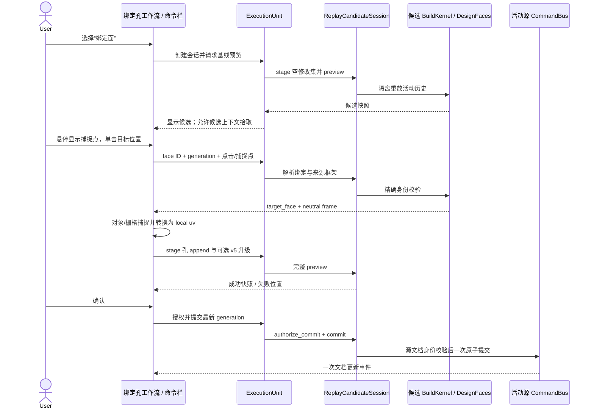

# E3-B：绑定孔 GUI 工作流设计

日期：2026-11-02 
状态：设计待实施；已按后续三维基础需求调整依赖，具体实现尚未开始。 
依据：[ADR-014 命令实例身份](../../adr/ADR-014-command-instance-identity.md)、[ADR-015 绑定面孔](../../adr/ADR-015-bound-face-hole.md)、[E3 下一项任务 TODO](../../design/n3-e3-next-task-todo-2026-11-02.md) 与当前 E3-A 候选会话实现。

## 2026-11-02 三维基础依赖修订

用户选择的独立工作流模块、复用孔控件、对象捕捉 + U/V + 栅格开关继续有效。后续要求补齐三维草图、多坐标系和辅助平面，因此本设计的框架/拾取/捕捉基础统一遵循[三维建模基础框架修订](2026-11-02-3d-modeling-foundation-design.md)，先实施 M0–M2 的共享契约与定位能力，再接 E3-B。以下孔交互和 ADR-015 绑定语义保留；不再为孔单独建立第二套空间上下文。

`GLViewport._current_snapshot()` 当前仍取已提交模型，故“可显示候选”不表示“已有候选拾取”。需让显示、射线拾取、精确锚点和返回 ID 共享同一候选 generation；最终成孔预览中重新选面时，回到用于选面的基线候选，再解析其 ID。捕捉只填入数值，不隐含对边/顶点的永久关联；手工修改 U/V 不再次自动吸附。孔的 U/V 固定属于来源设计框架，激活用户坐标系不能重解释既有孔位。

以下 v4→v5 规则仅适用于 v4/v5 源档案。M0 新格式落地后，E3-B 必须显式支持已包含 datum/关联草图的新版本历史：源 v6 保持 v6，不降成 v5；候选完整重放其新命令；未支持的命令清楚拒绝，不能跳过。支持矩阵及回归在 E3-B 实施计划中补齐。

## 目标

在现有孔控件中加入明确的“绑定面”来源，并用独立 UI 工作流把选面、捕捉/数值定位、局部点位、候选几何预览、用户确认和 E3-A 原子提交连接起来。用户选中的面必须来自候选重放内核；位置必须从视口实际命中点或选中的精确捕捉点转换到 E2-B 固定的来源设计框架；任何候选失败或取消都不能改动活动文档。

已有“面上点位”和“草图”两种孔来源保持当前语义。v4 文档只有在用户确认成功候选时才随绑定孔一起升级到 v5；确认前持续、明确地显示该格式变化，取消保持原档案及其历史不变。

## 非目标

- 不实现 E3-C 的历史失效诊断、重选修复或 split/merged 后继选择，也不扩展持久拓扑引用契约。
- 不支持除 ADR-015 已列 primitive 角色之外的可绑定面，不对 unsupported/deleted/split/merged 面做查询、rank、最近面或自动选面回退。点位捕捉仅在用户已指向的当前候选面内计算。
- 不改普通面上查询孔与草图孔的参数解释、选面来源、确认路径或数据格式。
- 不把 SketchEditor 中依赖第二个构造锚点的垂足/切点推理扩展到单击式孔中心定位；本切片不提供自动约束关系或跨面捕捉。
- 不提供“撤销整个绑定工作流/格式升级”的新撤销语义。已提交孔沿用现有命令 undo；用户取消工作流时则候选完全不提交。
- 不扩展到孔阵列、商业 CAD 对齐、任意 fillet/chamfer 后继、MCP/网络/LLM 或 GUI 外的命令入口。

## 当前状态与差距

- `ReplayCandidateSession` 已能对活动历史建立隔离候选、保留成功候选内核、校验候选 generation，并经源 Bus 授权后一次性提交。
- `BuildKernel.interactive_face_binding(identity)` 能基于候选内核中的精确拓扑 ID 生成持久绑定描述。它尚未接收实际点击点，也未返回局部 `uv_mm`。
- `DesignFaces` 保存 ADR-015 定义的原始 primitive 面框架并用其解析局部坐标；但尚无从世界命中点转换到该框架 `uv` 的方法。UI 不能从裁切后的当前面中心自行推算局部坐标。
- 视口将最后一次 face ray hit 保存为私有状态；候选显示快照可渲染，但当前 MainWindow 选面处理器会把选择交给活动源内核。E3-B 必须增加候选作用域的选择交接与可验证命中点访问。
- `ModelingCommandBar` 已有孔径、深度、预览和确认/取消控件，孔来源目前只有“面上点位”和“草图”。
- `SketchEditor` 已有可复用的交互约定：对象捕捉与栅格捕捉分开控制；对象捕捉默认开启，栅格捕捉默认关闭；使用 12 px 捕捉半径；按住 Shift 临时关闭两类捕捉，并按端点、交点、垂足、切点、圆心、中点、中心的既有顺序处理同距候选。3D 视口当前还没有光标捕捉引导。

## 采用路线

采用用户选择的“独立工作流模块，复用现有孔控件”。新增一个聚焦绑定孔的 UI 工作流模块，由 `MainWindow` 负责连接现有命令栏、视口、活动文档生命周期与 `ExecutionUnit`；该模块承担 E3-B 状态与候选会话操作。命令栏只增加绑定来源选项和持续可见的 v4→v5 格式提示，不复制孔径、深度、预览或确认控件。普通两条孔路径继续走原有 MainWindow 流程。

替代路线：把候选会话状态机直接塞进 `MainWindow` 会扩大其职责并增加普通孔回归风险；新建整套独立孔面板会重复现有控件和交互。上述两条不采用。

## 交互流程

1. 用户从孔来源选择“绑定面”。工作流建立绑定模式会话，锁定当前文档身份、文件身份、revision 和 UI session，并用 `ExecutionUnit` 建立候选会话。
2. 工作线程通过 E3-A 会话完整重放当前历史并返回候选快照。视口显示该候选快照，并把选面输入路由到此候选上下文；开始新候选 generation 时清空上一个 generation 的选中面与命中点。
3. 用户在候选模型上移动光标。视口仅对光标下的候选面预选；若该面支持绑定，就在面内可见的精确捕捉点中按屏幕距离和既有优先级寻找 12 px 范围内的目标，并显示捕捉标记及名称。首版捕捉点为该面顶点/端点、边中点、圆弧/圆边中心以及来源设计框架原点；面边界交汇使用其精确共享顶点。候选快照为中立 `ViewportSnapPoint` 提供面内精确世界点和类型，几何适配层通过 BREP 得到锚点，不从渲染折线近似圆心或曲线中点。不同捕捉点同距时沿用 SketchEditor 优先级中适用的顺序：端点、交点、圆心、中点、中心。无对象候选命中时，栅格开关如启用则在来源框架的 U/V 平面网格中捕捉；对象捕捉优先于栅格；按住 Shift 临时关闭两种捕捉。捕捉半径与草图编辑保持 12 px，栅格间距遵循 1/2/5 递进的可见尺度规则；栅格可见性与栅格捕捉开关分离。
4. 用户单击时将候选 face ID、候选 generation、实际世界命中点和选中的捕捉类型交给工作流。中立候选接口校验该面属于当前成功候选，返回持久绑定引用以及 ADR-015 设计框架（原点、U/V 轴、法向）；UI 用该中立框架将命中点/捕捉点转成 `uv_mm`，法向方向网格误差投影到面内，但不改变 U/V。几何执行端再次用精确有限面校验；位于外边界外或落入已有孔洞的点拒绝，不做最近点或面内吸附。未绑定、歧义、失效、曲面或不支持来源均返回可用于 UI 的明确原因。
5. 控件提供“捕捉”对象捕捉勾选框（默认开）、独立“栅格捕捉”勾选框（默认关）和可编辑 U/V mm 数值框。单击时字段显示最终捕捉/落点；数值改动后以 U/V 直接成为新位置，并触发候选预览。按住 Shift 只对当前拾取临时禁用对象与栅格捕捉，不改控件持久开关。用户可更换目标面；换面后旧最终预览立即失效。孔径、深度或 U/V 变化也立即禁用确认并使旧候选结果失效。
6. 工作线程把一条 `feature.hole@3` append 和 `upgrade_to_v5=(源档案为 v4)` 一起 stage 到同一候选会话，再完整重放历史。视口显示含新孔的最终候选快照。失败时显示命令位置/原因并保持源文档不变，用户可以改参数、换面或取消。
7. v4 来源在最终预览及确认按钮可用期间显示持续提示：确认会使当前文档改用 v5 格式保存；取消不会迁移活动文档。v5 来源不显示迁移提示。
8. 用户点击现有确认控件后，工作线程只对最新成功 generation 调用 `authorize_commit` 和 `commit`。成功后更新活动模型显示并结束工作流；重复点击、旧回调、来源文档变化和过期 generation 均不能提交。取消、切换普通来源、结束命令或关闭/替换文档时调用候选 cancel、释放临时内核并还原活动模型视图。

简化时序：

## 设计约束与边界

- **层次**：局部坐标转换留在 `geom` 的 DesignFaces/BuildKernel；应用候选会话经 `app.py` 中立门面调用；`ui` 只传 topology ID、generation 和普通数值坐标，不接触 build123d/OCP 或 native shape。`core` 不引入 CAD 后端。
- **坐标**：局部 frame 必须复用 ADR-015 的来源 primitive 原始面中心与方向；不得使用当前被裁切面的中心重建原点。位置转换不能落入受保护 core 层或产生运行期 TopologyId 持久化。
- **捕捉**：捕捉只影响定位，不替代目标面选择；对象捕捉来源限于候选快照当前有限面内的精确边界锚点及来源 U/V 原点。不得由三角化折线生成持久捕捉坐标。栅格在来源局部 U/V 框架上；所有候选最终仍经 `feature.hole@3` 精确面内校验。
- **线程**：候选创建、stage、preview、局部绑定求解、授权、commit/cancel 和任何几何调用均由串行 `ExecutionUnit` 工作线程执行。GUI 线程只响应中立结果和更新 Qt 控件。
- **隔离**：基线显示与最终预览都由候选内核提供。选择上下文必须与当前成功候选 generation 匹配，候选快照替换时旧 ID/命中点马上失效；该路径不能调用 `services.kernel.interactive_selectors`。
- **提交**：只使用 E3-A 源 Bus 一次性授权流程；应用层不得直接写 `Document`、直接替换活动 kernel 或单独先提交 v5 升级。
- **生命周期**：文档/文件/revision 或 UI session 改变、候选状态过期、模式切换、取消、关闭时均阻断旧回调及确认并释放候选资源。工作流的取消不改变活动档案、dirty、redo、命令身份或几何。
- **审计**：绑定孔按 GUI 既有 actor 约定写入确认人（`local`）；原命令审计字段和 amendment 规则继续由 E3-A Bus 提交逻辑负责。

## 预计修改面

- `src/mycad/ui/bound_hole_workflow.py`：新增独立交互协调器，表达绑定工作流状态、基线/最终预览阶段、候选 session/generation、失败消息及确认/取消入口。
- `src/mycad/ui/main_window.py`：绑定工作流与现有命令栏、选择事件、活动文档 lifecycle、串行执行器及候选快照/提交后的刷新作最小连接；普通 face/sketch 分支保持原路径。
- `src/mycad/ui/modeling_toolbar.py`：孔来源增加 `bound_face`；复用直径/深度、现有确认/取消；加入可持续显示格式升级信息的提示控件及定位控件（见下）。
- `src/mycad/core/viewport_protocol.py`、`src/mycad/geom/query.py`：增加中立 `ViewportSnapPoint` 快照数据，仅暴露精确候选面拥有的顶点、曲线中点/中心锚点及其类型。
- `src/mycad/ui/viewport.py`：复用 M2 共享 InteractionContext 与定位服务，让射线拾取真正使用候选快照；公开候选命中信息，显示精确捕捉点标记/名称，支持对象/栅格捕捉和 Shift 临时关闭；generation 切换时清理选中与 hit 状态。
- `src/mycad/ui/modeling_toolbar.py`：绑定定位区加入对象捕捉/栅格捕捉独立开关及可编辑 U/V mm 控件；普通 face/sketch 模式保持控件原样。
- `src/mycad/geom/design_faces.py`、`src/mycad/geom/kernel.py`：返回 DesignFaces 来源局部框架和精确绑定面捕捉锚点；负责有限面验证，明确对象捕捉不依赖显示 tessellation。
- `src/mycad/app.py`：扩展候选会话的中立拾取 API，接受 candidate face ID、world hit 和 generation，返回绑定引用、来源局部框架与锚点；session/source 检查在这里复用。
- `src/mycad/core/kernel_protocol.py`：仅在应用门面需要运行时协议契约时扩展可选 capability；仍保持 neutral inputs/outputs。
- 测试镜像 UI、geom、app 路径，沿用真实几何回归验证；添加 `.omo/evidence/e3b-bound-hole-gui/acceptance.md` 记录执行结果。

上面是预计文件范围，具体接口名由实施计划确定；不应为方便绕过既有 layering 或线程模型。

## 验收场景

1. 孔来源列出“面上点位 / 草图 / 绑定面”；原两分支的参数、预览与提交回归结果不变。
2. 在支持的 box/cylinder primitive 当前保留面上选点：对象捕捉能提供面顶点/端点、边中点、圆心/局部原点等点；捕捉标记类型正确，等距候选优先级与草图编辑一致，捕捉点在非对称裁切前后均基于稳定来源局部框架。选中后 U/V 数值与实际局部坐标相符。
3. 栅格捕捉独立开关能在局部 U/V 网格对齐，捕捉点受同一屏幕像素容差限制；隐藏/关闭栅格不影响对象捕捉；按住 Shift 临时关闭两类捕捉，松开后恢复控件状态。
4. 在新生成面、孔壁、非平面、split/merged、已删除或不唯一来源面点击：不调用查询/rank fallback，不生成 binding；UI 当场说明可操作原因，源模型不变。点位不会吸附到已移除区域或已有孔洞。
5. 直接编辑 U/V 数值能更新候选孔位；快速改直径/深度、换目标、连续确认、在预览中取消、切换普通孔来源、切文档/Save As/undo/redo 导致来源 revision 变化：旧 generation 不可确认或提交，旧候选显示和选择不会污染活动视图。
6. v4 文档绑定成功后只有一个受控提交结果：档案变 v5 并追加孔；取消/预览失败/授权前来源变化时，格式、命令与 redo 均不变。
7. v5 文档绑定成功不再提示格式迁移，但仍须完整预览后确认。
8. 所有几何与候选生命周期操作均在 `ExecutionUnit` 上执行；窗口保持响应，过期工作线程回调不会覆盖较新候选或活动模型。
9. 运行改动路径的 Ruff/格式/basedpyright/pytest 和 layering 检查；测试需要证明真实最终 hole geometry 与候选原子提交一致，而非只断言 DTO。

## 待审阅决策

- 已采用：绑定来源作为现有孔控件中的第三个显式选项；绑定分支用候选预览和一次确认提交。
- 已采用：复用现有孔控件与执行线程，不扩到 GUI 外接口或 E3-C 修复。
- 已采用：定位区复用 SketchEditor 的对象/栅格捕捉开关与 Shift 临时关闭习惯，增加可编辑局部 U/V 数值；首版不增加依赖第二个锚点的垂足/切点。
- 已采用：对 v4 只在最终候选中附带 v5 升级；升级说明在确认前持续可见。
- 本设计没有需要用户另外选择的交互分支。候选模块内状态命名、信号签名、精确 tolerance 和测试拆分由实施计划与实现确定，并受上述不变量约束。
