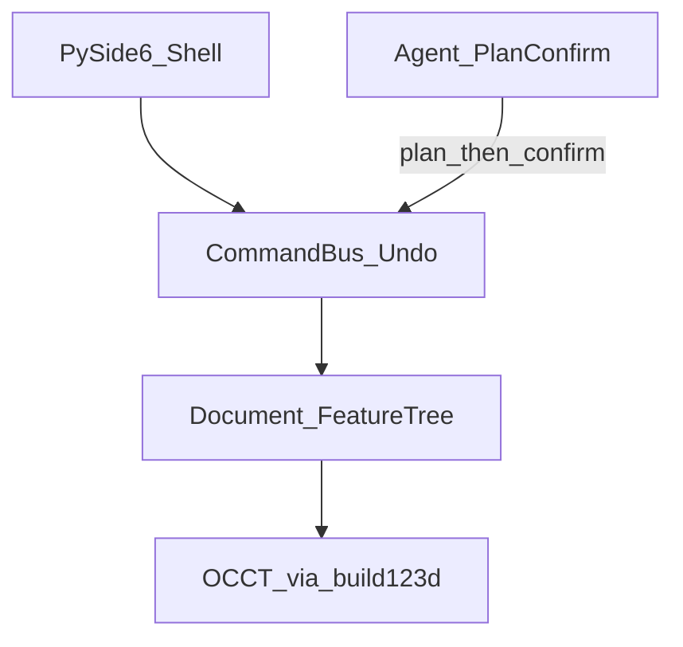
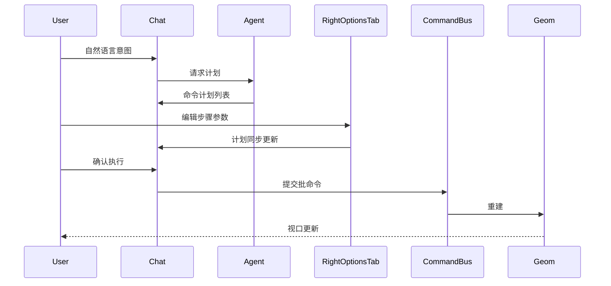

# MyCAD 技术路线

| 项 | 内容 |
|----|------|
| 文档版本 | 0.1 |
| 状态 | 基线初稿 |
| 许可证 | Apache License 2.0 |
| 关联文档 | [需求分析书](需求分析书.md)、[UI 设计初稿](UI设计初稿.md) |

---

## 1. 选型结论

采用 **方案 B：Python 建模栈 + 自研桌面壳**。

| 层级 | 选型 | 说明 |
|------|------|------|
| 几何内核 | OpenCascade（OCCT）7.x | 开源 B-rep；STEP/IGES 互通 |
| 建模 API | **build123d**（首选）或 CadQuery | 可读脚本，利于 Agent 生成与人工审阅 |
| 桌面 UI | **PySide6**（Qt6） | 嵌入 OCCT/VTK 视口成熟；不采用 Kivy |
| 可视化 | 优先 OCCT AIS 嵌入 Qt；早期可用网格预览过渡 | 视口手感与 UI 壳解耦演进 |
| 智能体 | 同进程或本地 sidecar + Tool/命令层 | **只生成计划，确认后才执行** |
| LLM | 云端 API 起步；可接本地（如 Ollama） | 无模型时 GUI/CLI 仍可用 |
| 发行许可 | Apache-2.0 | 比 MIT 多专利与 NOTICE；非 GPL |

曾评估但否决：以 FreeCAD 为产品壳（方案 A，品牌与架构受限）；纯 C++ OCCT+Qt 首期（方案 C，人力过重，可作后期下沉）；Kivy 主 UI（视口与桌面控件成本过高）。

---

## 2. 架构原则

1. **单一写入路径**：一切改模型操作进入 **Command Bus**（含 Undo/Redo 与批事务）。
2. **多入口同源**：Chat 确认后的计划、CLI、左栏命令、Toolbar，最终都变为同一类 Command。
3. **计划与执行分离**：Agent 默认只产出 Plan；用户确认后 Bus 才提交。
4. **Document 为真相源**：特征树 / 参数与几何后端分离；视口与右栏「结构」是视图。
5. **UI 可注册扩展**：左栏项、右/底 Tab 通过注册 API 挂载，避免改主窗口硬编码。

---

## 3. 逻辑架构



### 3.1 模块职责

| 模块 | 职责 |
|------|------|
| `ui` | 菜单、Toolbar、左栏、视口容器、右栏 Tabs、底栏 Chat/CLI、状态栏 |
| `commands` | 命令定义、参数 schema、序列化、与 CLI 文案映射 |
| `core` | Document、特征历史、选择集、事务/Undo |
| `geom` | OCCT/build123d 适配、网格化、导入导出 |
| `agent` | LLM 调用、计划生成与校验、与确认 UI 协议 |

### 3.2 确认执行数据流



---

## 4. 关键环境与依赖策略

- **一级平台**：Ubuntu 22.04 / 24.04。
- **推荐开发环境**：conda-forge 提供 OCCT 与相关绑定，降低系统库冲突；或系统 `libocct-*` + venv（在文档中固定一种为主、另一种为附录）。
- **Python**：3.10+（与 PySide6、build123d 当前支持对齐，实现时锁定次版本）。
- **打包（后期）**：AppImage 或 Flatpak；开发期不以打包为阻塞。

---

## 5. 阶段演进

与 [需求分析书](需求分析书.md) 分期一致，技术侧细化如下。

### 阶段 0 — 可编程 MVP

- 无完整 CAD 壳：脚本创建几何 → 简单 3D 预览 → STEP/STL。
- 定义第一批 Command schema（拉伸、圆柱、孔阵列等）。
- 验证 conda/依赖一键可复现。

### 阶段 1 — 桌面壳

- PySide6 主窗口按 [UI 设计初稿](UI设计初稿.md) 落地。
- Command Bus + Undo；结构树与属性联动。
- OCCT 视口嵌入（若阻塞则网格预览占位，接口保持稳定）。

### 阶段 2 — Agent 闭环

- Plan → 确认 → 执行全链路。
- 建立小型评测集（自然语言 → 期望参数/实体检查）。
- CLI 与计划文案对齐；失败回滚与错误回灌。

### 阶段 3 — 特征加深

- 草图与约束、更多修改特征；装配按需。
- 性能热点可 C++ 扩展，Python 命令层保持稳定。

---

## 6. 建议仓库目录

本次仅规划，不强制已存在于磁盘：

```text
MyCAD/
├── LICENSE
├── NOTICE
├── README.md
├── docs/
│   ├── 需求分析书.md
│   ├── 技术路线.md
│   └── UI设计初稿.md
├── src/
│   └── mycad/
│       ├── __init__.py
│       ├── ui/           # PySide6 壳与各面板
│       ├── core/         # Document、选择、事务
│       ├── commands/     # 命令定义与注册
│       ├── geom/         # OCCT / build123d 适配
│       └── agent/        # 计划生成与校验
├── tests/
├── assets/               # 图标、QSS、示例模型
└── pyproject.toml        # 后续添加
```

---

## 7. 命令与 Agent 协议（基线）

- 每条命令：稳定 `id`、JSON 可描述参数、可选 CLI 语法、撤销补偿信息。
- 计划对象：有序命令数组 + 人类可读摘要；状态为 `draft | confirmed | executing | done | failed | cancelled`。
- 校验器（执行前）：参数类型/范围、明显非法拓扑意图（能静态抓的先抓）。
- **禁止**默认让 LLM 在无沙箱下执行任意 Python；若提供脚本节点，必须受限 import、超时与工作目录。

---

## 8. 风险与缓解

| 风险 | 影响 | 缓解 |
|------|------|------|
| OCCT 视口嵌入 Qt 复杂 | 阶段 1 延期 | 网格预览占位；接口与最终 AIS 视口互换 |
| 拓扑命名 / 特征编辑脆弱 | 改参失败 | 首期少做「强参数化编辑」，多种子重建；评测集锁定场景 |
| LLM 不稳定 | 错误建模 | 强制确认；计划可编辑；评测回归 |
| 依赖安装因发行版而异 | 上手成本 | 文档锁定一条官方安装路径 |
| 范围膨胀（装配/工程图） | 资源稀释 | 严格按需求分析 Out 列表 |

---

## 9. 开源与第三方

- 项目代码与文档：Apache-2.0（见根目录 `LICENSE`、`NOTICE`）。
- OCCT、Qt（PySide6）、build123d/CadQuery 等遵循各自许可证；发行时在 `NOTICE` 或第三方清单中补充归属。
- 不引入 GPL/AGPL 作为项目主许可证；若未来依赖强制 copyleft，需单独评估并更新本文件。

---

## 10. 非目标（技术）

- 不自研 B-rep 内核。
- 不以 Electron/Web 为主壳。
- 不把 Node-RED 运行时嵌为建模核心。
- 首期不做多人文档实时协同后端。
